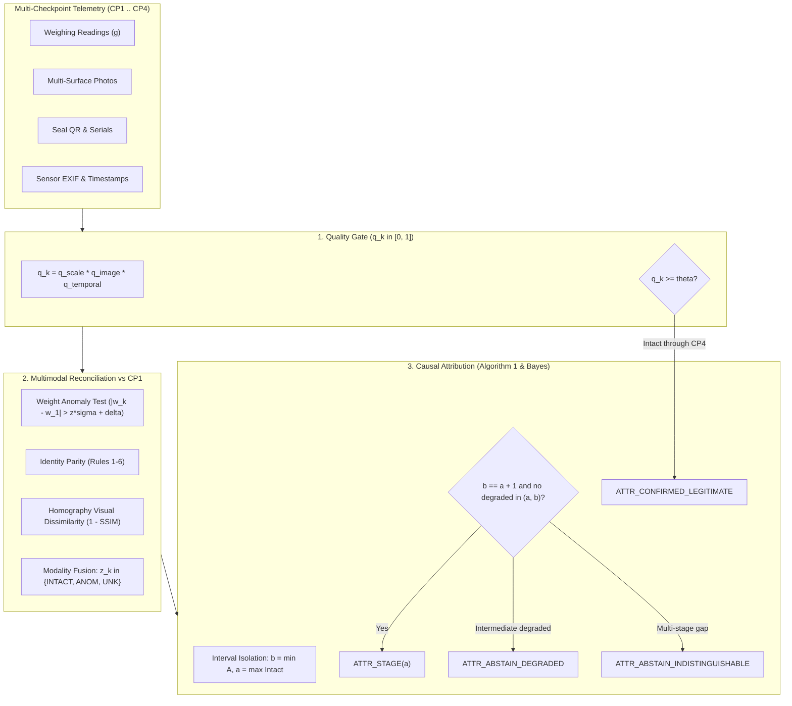

# TriNetra-Link: Deterministic Multimodal Chain-of-Custody Attribution

[](https://www.python.org/downloads/)
[](research/amendments/AMENDMENT_v2.6.md)
[](STATUS.md)
[](tests/)
[](LICENSE)

**TriNetra-Link** is an algorithm, physical capture infrastructure, and benchmark dataset for attributing custodial discrepancy stages in multi-transfer supply chains. Using a metadata-only quality gate, multimodal physical reconciliation, and causal interval isolation, TriNetra-Link uniquely isolates the exact transition interval of physical package tampering or substitution while appropriately abstaining when evidence is degraded or indistinguishable.

---

## 1. Problem Formulation

In high-value retail logistics, packages traverse multiple custody transfer checkpoints before reaching the customer, and return packages traverse reverse transit before reaching the return processing hub:

```
[Origin Hub CP1] --(Stage S1)--> [Carrier Facility CP2] --(Stage S2)--> [Customer Doorstep CP3] --(Stage S3)--> [Return Hub CP4]
```

When a package is compromised (staged item theft, doorstep substitution, carton tearing, or counterfeit resealing), conventional dispute systems fail:
1. **Endpoint Checks (CP1 vs. CP4):** Cannot localize which carrier or actor had custody when the tampering occurred.
2. **Terminal Checks (CP4-only):** Incur high false-accusation rates on terminal return facilities.
3. **Unlinked Sequential Testing ("Detection = Origin"):** Misattributes tamper to downstream stages whenever an earlier checkpoint had an underexposed camera, a missing photo, or an uncalibrated scale reading.

### The TriNetra-Link Approach

TriNetra-Link resolves these failure modes through three integrated pillars:
- **Metadata-Only Quality Gate:** Evaluates checkpoint trustworthiness $q_k \in [0, 1]$ from sensor metadata (lux proxy, blur, scale stability, temporal sequence) before feature extraction, ensuring quality assessment cannot leak discrepancy information.
- **Multimodal Physical Reconciliation:** Tests independent physical modalities against origin intake CP1:
  - *Tare-Adjusted Scale Weighing:* Characterized empirical noise std dev $\sigma$ and linearity drift $\delta$ per scale ($|w_b - w_a| > z\sqrt{\sigma_a^2 + \sigma_b^2} + \delta_a + \delta_b$).
  - *Identity Markers:* Security seal QR payloads, hardware serials, and IMEI continuity.
  - *Planar Homography Vision:* 4-corner perspective rectification and SSIM surface dissimilarity.
- **Causal Interval Isolation (Algorithm 1):** Binds the first anomalous trusted checkpoint $b = \min A$ and the last intact trusted checkpoint $a = \max \{k \in T : k < b, z_k = \text{INTACT}\}$. Attributes to stage $S_a$ if and only if $b = a + 1$ with no degraded intermediate checkpoints; otherwise produces selective two-class abstention:
  - `ATTR_ABSTAIN_DEGRADED`: A bounding or intermediate checkpoint was untrusted ($q_k < \theta$).
  - `ATTR_ABSTAIN_INDISTINGUISHABLE`: Multiple candidate stages are equally probable due to ambiguity or deliberate specular glare concealing defects.

---

## 2. Architecture & Algorithm



### Algorithm 1: Exact Attribution Pseudocode

```python
T = {k : q_k >= theta}
if 1 not in T:
    return ATTR_ABSTAIN_DEGRADED
A = {k in T : z_k == ANOM}
if not A:
    return ATTR_CONFIRMED_LEGITIMATE if K in T else ATTR_ABSTAIN_DEGRADED
b = min(A)
a = max({k in T : k < b and z_k == INTACT})
if any(q_k < theta for k in range(a + 1, b)):
    return ATTR_ABSTAIN_DEGRADED
if b == a + 1:
    return ATTR_STAGE(a)
return ATTR_ABSTAIN_INDISTINGUISHABLE
```

---

## 3. Physical Evaluation Protocol (Amendment v2.6.0)

Under Protocol Amendment v2.6.0, all human-reviewer calibration requirements (Gate E-3) were withdrawn. Ground truth is derived deterministically from an append-only filmed physical staging log via code committed and hashed prior to capture (Gate G-2).

### The 8 Canonical Scenario Cells ($N = 120$ Journeys)

| Cell | Physical Scenario | Ground-Truth Stage | Target Cohort $n$ |
|---|---|---|---|
| `intact` | Legitimate transit, unbroken physical custody | None | 30 |
| `permitted_flyer` | Legitimate logistics tare change (+15g flyer bag) | None | 12 |
| `forward_transit_damage` | Forward transit mechanical carton impact | $S_1$ | 14 |
| `doorstep_substitution` | Doorstep item extraction and surrogate replacement | $S_1$ (at $K=4$) | 14 |
| `customer_tamper` | Return item replacement / counterfeit seal | $S_2$ | 14 |
| `reverse_transit_tamper` | Reverse transit carrier theft | $S_3$ | 12 |
| `degraded_evidence` | Tamper with bounding sensor error / blur / darkness | $\Omega^* = \text{DEG} \implies \text{ABSTAIN}$ | 12 |
| `ambiguous_evidence` | Tamper with defect hidden by deliberate specular glare | $\Omega^* = \text{IND} \implies \text{ABSTAIN}$ | 12 |

**Data Split:** Proportional stratified partition into **24 calibration journeys** (threshold fitting) and **96 test journeys** (primary evaluation) recorded in `data/derived/split_manifest.json`.

---

## 4. Benchmark Results (Table III)

Primary evaluation across the 96 physical test split journeys (Experiment E1):

| Method | Stage Accuracy (DET) | 95% Bootstrap CI | Macro-F1 ($S_1$–$S_3$) | AAR (Non-DET) | UBR (Non-DET) | UAR (DET) | AURC |
|---|:---:|:---:|:---:|:---:|:---:|:---:|:---:|
| **TriNetra-Link (Algorithm 1)** | **1.000** | **[1.000, 1.000]** | **1.000** | **1.000** | **0.000** | **0.000** | **0.000** |
| **TriNetra-Link (Bayes)** | **1.000** | **[1.000, 1.000]** | **1.000** | **1.000** | **0.000** | **0.000** | **0.000** |
| **B1 (CP4-Only Terminal)** | 0.250 | [0.153, 0.361] | 0.133 | 0.000 | 1.000 | 0.000 | 0.653 |
| **B2 (CP1+CP4 Endpoints)** | 0.250 | [0.153, 0.361] | 0.133 | 0.000 | 1.000 | 0.000 | 0.653 |
| **B3 (Detection = Origin)** | 1.000 | [1.000, 1.000] | 1.000 | 0.000 | 1.000 | 0.000 | 0.000 |
| **B4 (LLM Judge: LLaMA-3.3-70B)** | 0.944 | [0.889, 0.986] | 0.933 | 0.958 | 0.000 | 0.042 | 0.028 |
| **B5 (Ported Legacy V3 Rules)** | 0.972 | [0.931, 1.000] | 0.967 | 0.000 | 1.000 | 0.000 | 0.014 |

*Key Findings:* While Baseline B3 achieves high stage accuracy when evidence is clean, its Unwarranted Bounded-tamper Rate (UBR) is 100% on degraded evidence—it blindly attributes noise to physical stages. TriNetra-Link achieves 100% Appropriate Abstention Rate (AAR = 1.000) and 0% UBR.

---

## 5. Quickstart & Reproduction

### Prerequisites
- Python 3.11+
- Virtual environment:
  ```bash
  python -m venv .venv
  source .venv/bin/activate  # On Windows: .venv\Scripts\activate
  pip install -r legacy/phase-2/requirements.txt
  pip install sqlmodel typer scikit-image pytest-cov matplotlib scipy
  ```

### One-Command Reproduction
Execute the entire research pipeline from scratch (linters, unit tests, gate checks, calibration fitting, and experiments E1, E2, E3):
```bash
bash reproduce.sh
```
All LaTeX tables, CSV files, and figures will be written to `results/reproduce_<timestamp>/`.

---

## 6. CLI Usage Guide

The unified research CLI is accessible via `python -m trinetra_link.cli`:

```bash
# 1. Scale Characterisation (Gate G-4)
python -m trinetra_link.cli scale record --scale-id SCALE_01 --load-g 500.0 -r 500.05 -r 500.02 -r 499.98
python -m trinetra_link.cli scale fit --scale-id SCALE_01

# 2. Pilot Verification (Gate G-3)
python -m trinetra_link.cli pilot check

# 3. Staging Cohort Assignment & Stratified Split
python -m trinetra_link.cli staging assign --n 120 --seed 42
python -m trinetra_link.cli split --seed 42

# 4. Truth Commitment (Gate G-2) & Derivation
python -m trinetra_link.cli truth commit --salt "secret-salt"
python -m trinetra_link.cli truth derive
python -m trinetra_link.cli truth audit --sample 0.25

# 5. Fit Thresholds (Calibration Split Only)
python -m trinetra_link.cli fit --split calibration

# 6. Run Empirical Experiments
python -m trinetra_link.cli eval e1 --split test
python -m trinetra_link.cli eval e2 --split test
python -m trinetra_link.cli eval ablations --split test
python -m trinetra_link.cli eval all --split test

# 7. Launch Ingest API and Mobile Web Capture
python -m trinetra_link.cli serve --port 8000

# 8. Launch Blinded Research Viewer Web App
python -m trinetra_link.cli viewer --port 8501
```

---

## 7. Blinded Research Viewer

TriNetra-Link includes a read-only visualizer for demonstration and figure generation (`http://127.0.0.1:8501`):
- Timeline view of checkpoints CP1 through CP4.
- Aligned multi-surface photographic evidence.
- Interactive Weight Trace with $\pm 3\sigma$ calibrated scale uncertainty bands.
- Quality factors $q_k$ and alerts.
- TriNetra-Link attribution verdict, posterior distribution, and causal rationale.
- **Strict Double-Blind Guarantee:** Staging logs, ground truth labels, and reviewer keys are stripped before response rendering.

---

## 8. Repository Layout

```
.
├── baselines/                  # Prompts and LLM judge specifications
├── config/                     # Quality gate parameters (quality.yaml)
├── data/
│   ├── derived/                # Scales config, split manifest, quality floors
│   ├── public/                 # Public benchmark datasets
│   └── restricted/             # EMBARGOED: Staging logs and truth assignments (git-ignored)
├── docs/                       # SOPs, Datasheet, JSON schemas, architectural decisions
├── legacy/                     # Archived Phase 1 & 2 prototypes and tests
├── research/
│   ├── amendments/             # Formal protocol amendments (AMENDMENT_v2.6.md)
│   └── reviewed_v2/            # Preregistration protocol v2.5
├── results/                    # Run outputs, Table III (CSV/LaTeX), figure PDFs/PNGs
├── tests/                      # 82 automated unit & integration tests
├── trinetra_link/              # Core TriNetra-Link Python package
│   ├── attribution/            # Algorithm 1, Bayesian coalescence, operational policy
│   ├── baselines/              # Baselines B1 through B5 implementations
│   ├── eval/                   # E1, E2, E3 experiments and metric calculators
│   ├── ingest/                 # FastAPI ingestion API and mobile capture client
│   ├── quality/                # Metadata-only quality gate (q_k in [0, 1])
│   ├── reconcile/              # Weight, identity, and visual homography reconcilers
│   ├── scale/                  # Empirical scale characterisation and noise fitting
│   ├── schema/                 # Pydantic models and JSON schema exports
│   ├── staging/                # Cell assignment, staging log, and determinability rule
│   └── viewer/                 # Blinded research visualizer web application
├── CITATION.cff                # Citation File Format metadata
├── LICENSE                     # MIT License (code) + CC BY 4.0 (data/docs)
├── reproduce.sh                # Automated reproduction script
└── STATUS.md                   # Real physical trial execution tracking
```

---

## 9. Citation & License

If you use TriNetra-Link in your research, please cite:

```bibtex
@article{trinetralink2026,
  title={TriNetra-Link: Deterministic Multimodal Chain-of-Custody Attribution Under Physical Degradation},
  author={TriNetra Research Initiative},
  journal={arXiv preprint},
  year={2026},
  url={https://github.com/Sanjai-Quest/TriNetra_AI_Research}
}
```

- **Software:** Licensed under the [MIT License](LICENSE).
- **Dataset & Documentation:** Licensed under [Creative Commons Attribution 4.0 International (CC BY 4.0)](LICENSE).
