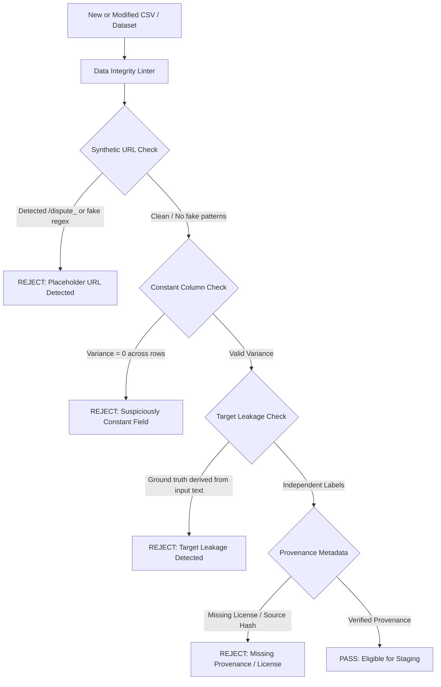

# TriNetra Data Engineering & Research Recovery Plan

**Engineering Authority:** Senior Data Engineering & Research Reproducibility Engineer  
**Scope:** Architecture Quarantine, Prevention of Recurrence, and Clean Research Realignment  
**Date:** October 2026  
**Status:** PROPOSED (Pending User Review & Approval before Execution)

---

## 1. Executive Summary & Remediation Objectives

The objective of this recovery plan is to rectify the data engineering failures identified in the Phase 0 audit, ensure total transparency, prevent any recurrence of synthetic data masquerading as real complaints, and realign the repository with its true research contribution: **Pre-Delivery Physical Custody Verification**.

The recovery follows five strict engineering principles:
1. **Never conflate synthetic generation with empirical data collection.** Synthetic datasets must be explicitly labeled `[SYNTHETIC]`, housed in dedicated mock directories, and never described as authentic consumer grievances.
2. **Never treat consumer allegations as physical ground truth.** A consumer claim stating "received soap instead of smartphone" is an unverified allegation; it does not constitute physical proof of substitution or fraud without chain-of-custody corroboration.
3. **Decouple legacy post-delivery dispute research from current pre-delivery physical logistics verification.**
4. **Purge database contamination** that linked fake complaint IDs (`CMP_00001`–`CMP_00003`) to physical serialized logistics units.
5. **Establish automated CI/CD data-integrity linters** to prevent target leakage, circular ground truth, and placeholder URL generation from ever entering the repository again.

---

## 2. Phase 1: Architectural Quarantine & Repository Realignment

To maintain backward compatibility and preserve auditability without silently deleting files, the repository will be restructured into two clearly separated, non-overlapping domains:

```
TriNetra_Mobile_FIXED/
├── audit/                                # Audit reports and provenance tables (Phase 0)
│   ├── file_inventory.csv
│   ├── dataset_provenance.csv
│   ├── row_quality_summary.csv
│   ├── label_and_leakage_findings.md
│   ├── result_reproducibility.md
│   └── recovery_plan.md
│
├── legacy_dispute_platform/              # QUARANTINED: Legacy consumer dispute research
│   ├── README_QUARANTINE.md              # Explicit disclosure of synthetic generation
│   ├── xscrapper/                        # Literature tool & mining scrapers
│   ├── phase-1/                          # Deterministic Python reconciliation engine
│   ├── phase-2/                          # Spring microservices & React dispute console
│   ├── phase-3/                          # Locust load testing assets
│   └── datasets/                         # customer_complaints_dataset.csv, etc.
│
├── trinetra_v3_logistics/                # ACTIVE RESEARCH: Pre-delivery physical verification
│   ├── android/                          # Mobile edge verification (Barcode, IMEI, BLE scale)
│   ├── backend/                          # Spring Boot V3 deterministic verdict engine
│   ├── specifications/                   # DECISION_ENGINE.md, UNIT_LIFECYCLE.md, etc.
│   └── test_fixtures/                    # Explicitly labeled synthetic logistics test cases
```

### 2.1 Remediation Actions for Phase 1:
1. **Database Seed Purge (`backend/src/main/resources/schema.sql`):**
   - Revert lines 298–326 that inserted `XS-CMP-00001`, `XS-CMP-00002`, `XS-CMP-00003` with fabricated complaint text.
   - Replace with authentic logistics test units (`UNIT-TEST-001` through `UNIT-TEST-005`) that represent realistic logistics scenarios (e.g., Factory Packing, Hub Intake, Return Receiving, Serial Mismatch, Seal Damaged).
2. **Quarantine Documentation:**
   - Add clear notices to `trinetra_real_complaints_expanded.csv` and `customer_complaints_dataset.csv` clarifying that they are synthetic scenario templates, not real consumer posts.
   - Update `REAL_DATA_DEMO.md` to remove claims that the demo uses real consumer complaints.

---

## 3. Phase 2: Prevention of Recurrence — Automated CI/CD Data Linters

To ensure that generated data can never again be checked into the repository disguised as real data, we propose implementing an automated data-linting suite: `scripts/ci_data_linter.py`.

### 3.1 Automated Quality Gates (Pre-Commit & CI Pipeline)



### 3.2 Specific Linter Rules:
1. **Placeholder URL Rule:**
   Scans URL columns against regex patterns: `r".*/dispute_\d+"`, `r"user_\d+/status"`, `r"instagram\.com/p/C5\d+"`, `r"reddit\.com/r/\w+In/comments/"`. If matched, rejects the commit.
2. **Column Invariance Rule:**
   Flags any dataset where fields like `evidence_missing`, `source_reliability`, or `classification_confidence` have 100% identical values across more than 50 rows.
3. **Timestamp Consistency Rule:**
   Enforces ISO-8601 (`YYYY-MM-DDTHH:MM:SSZ`) and verifies causality:
   $\text{Timestamp}_{\text{collection}} \ge \text{Timestamp}_{\text{publication}} \ge \text{Timestamp}_{\text{order}}$
4. **Simulation Forgery Rule:**
   Prohibits scripts from reporting simulated metrics or SLA passes when network endpoints fail. If an endpoint is offline, scripts must exit with a non-zero exit code.

---

## 4. Phase 3: Authentic Data Acquisition Protocol

If the research team wishes to conduct genuine studies on public consumer grievances, the following non-negotiable protocols must be established:

### 4.1 Permitted Sources and API Standards
- **Reddit:** Use official Reddit Data API via registered OAuth application credentials, adhering strictly to rate limits (100 QPS) and Reddit Developer Terms.
- **X (Twitter):** Use the official X API v2 (Academic Research Track / Developer Basic tier).
- **National Consumer Helpline:** Retain official Rajya Sabha and NCH published reports as **macro aggregate benchmarks only**, clearly labeled as macro statistics rather than granular dispute cases.

### 4.2 Ethical and Legal Compliance
1. **Terms of Service Compliance:** Web scraping behind login walls or bypassing anti-scraping mechanisms (e.g. bypassing Cloudflare, automated headless browsers masquerading as human agents) is strictly prohibited.
2. **PII Scrubbing:** Automatically redact all personal identifiers (usernames, phone numbers, email addresses, order IDs, tracking AWBs) using Presidio or regex anonymization before storage.
3. **Copyright & Fair Use Documentation:** Document the exact licensing terms for every harvested source in `datasets/dataset_manifest.json`.

### 4.3 Separation of Allegation from Ground Truth
Every authentic consumer complaint must be ingested into a schema that enforces epistemic separation:
- `raw_consumer_allegation`: Verbatim post text (subjective claim).
- `allegation_category`: Surface claim category (e.g. "Buyer alleges empty box").
- `physical_ground_truth_status`: Always defaulted to **`UNVERIFIED_CLAIM`**.
- **Rule:** A consumer allegation can NEVER be used as ground-truth proof that physical theft, fraud, or substitution occurred without independent warehouse CCTV or scale telemetry.

---

## 5. Phase 4: Scientific Benchmark Redesign for Physical Verification

The true engineering innovation of TriNetra is in **Pre-Delivery Physical Custody Verification**. Research validation must focus on this domain rather than text dispute classification.

### 5.1 Redesigned Pre-Delivery Evaluation Suite
We propose replacing the circular Phase 1 benchmark with a **Hardware-in-the-Loop Logistics Benchmark**:

```
Test Scenario Matrix (Pre-Delivery Physical Verification)
├── Scenario Group A: Identity Continuity
│   ├── Match: Serial & IMEI verified at Checkpoints 1, 2, 3 -> PASS
│   ├── Substitution at Return: Serial mismatch at Checkpoint 3 -> HOLD
│   └── Variant Swap: Counterfeit barcode detected -> HOLD
│
├── Scenario Group B: Chain of Custody & Security
│   ├── Sealed Handoff: Valid courier token + unbroken custody -> PASS
│   ├── Broken Custody: Missing handover checkpoint -> REVIEW / INVESTIGATION
│   └── Out-of-Sequence Scan: Hub scan timestamp preceding dispatch -> HOLD
│
└── Scenario Group C: Package Integrity
    ├── Damaged Box: Outer carton crushed / opened seal -> REVIEW
    └── Missing Component: Accessory barcode missing from bundle -> REVIEW
```

### 5.2 Fair Competitive Baselines
Instead of artificial single-attribute baselines, compare TriNetra against established industry standards:
1. **Industry Baseline 1 (Standard 1D Barcode Scan):** Traditional package tracking without serialized unit or IMEI inspection.
2. **Industry Baseline 2 (Single-Point Return QC):** Traditional warehouse receiving inspection without immutable multi-checkpoint history.
3. **TriNetra V3 (Continuous Serialized Multi-Checkpoint Custody):** Evaluated on detection rate of physical substitution, latency of divergence identification, and auditability.

---

## 6. Implementation Roadmap & Approval Checklist

To comply with the non-negotiable rule (*"Stop before modifying existing scripts or datasets. Wait for approval before proceeding to implementation"*), the following phased rollout will commence only upon explicit user sign-off:

```
[Phase 0: COMPLETED] Read-Only Audit & Forensic Findings
  ├── Produce audit/file_inventory.csv (COMPLETE)
  ├── Produce audit/dataset_provenance.csv (COMPLETE)
  ├── Produce audit/row_quality_summary.csv (COMPLETE)
  ├── Produce audit/label_and_leakage_findings.md (COMPLETE)
  ├── Produce audit/result_reproducibility.md (COMPLETE)
  └── Produce audit/recovery_plan.md (COMPLETE)

----------------------- USER APPROVAL GATE -----------------------

[Phase 1: PENDING APPROVAL] Quarantine & Database Cleanup
  ├── Step 1.1: Clean backend/src/main/resources/schema.sql (remove fake complaint seeds)
  ├── Step 1.2: Update REAL_DATA_DEMO.md and web console to clean logistics test units
  └── Step 1.3: Quarantine legacy dispute folders (xscrapper, phase-1, phase-2 datasets)

[Phase 2: PENDING APPROVAL] Automated CI Data Linting
  ├── Step 2.1: Implement scripts/ci_data_linter.py
  ├── Step 2.2: Add pre-commit hook blocking synthetic URLs and constant columns
  └── Step 2.3: Integrate lint check into Maven/Gradle/Python test pipelines

[Phase 3: PENDING APPROVAL] Physical Verification Benchmark Implementation
  ├── Step 3.1: Build authentic physical unit test fixtures (20 serialized test scenarios)
  ├── Step 3.2: Implement realistic baseline comparisons for logistics custody
  └── Step 3.3: Publish reproducible, peer-review-ready benchmark evaluation report
```

### Required Approval Sign-off:
- [ ] Approve repository quarantine structure (decoupling legacy dispute research from V3 logistics).
- [ ] Approve database cleanup (`schema.sql` seed replacement with clean logistics units).
- [ ] Approve implementation of CI data linter to prevent future synthetic data leakage.
